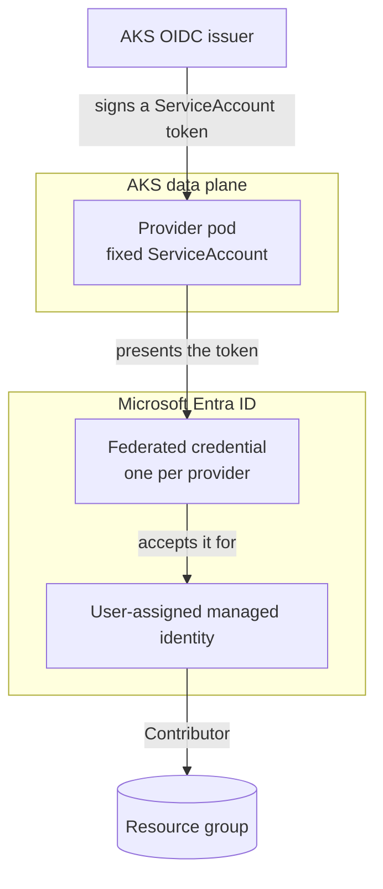

# Azure Backing

This backing builds the module's resources on Azure, using the Crossplane providers from the
[Azure provider family](https://github.com/crossplane-contrib/provider-upjet-azure). The providers
authenticate with AKS workload identity, so no cloud credential is stored in the cluster.

For how the module fits together, see the [module README](../README.md).

| Resource | Built as | Provider | Composition |
| :------- | :------- | :------- | :---------- |
| PostgreSQL | Azure Database for PostgreSQL Flexible Server | `provider-azure-dbforpostgresql` | [`postgres-composition.yaml`](postgres-composition.yaml) |
| Redis | Azure Managed Redis | `provider-azure-cache` | [`redis-composition.yaml`](redis-composition.yaml) |

| File | What it is |
| :--- | :--------- |
| [`provider.yaml`](provider.yaml) | The providers, set up for workload identity |
| [`provider-config.yaml`](provider-config.yaml) | Which identity, tenant and subscription the providers use |
| [`environment-config.yaml`](environment-config.yaml) | This data plane's Azure settings, read by every Composition |
| `<resource>-composition.yaml` | One Composition per resource |
| `render/<resource>/` | Sample inputs for checking a Composition without a cluster |

## How the providers authenticate

Each provider runs as its own pod, under a ServiceAccount with a fixed name. AKS gives that pod a
token signed by the cluster's OIDC issuer. A federated credential on a user-assigned managed
identity tells Microsoft Entra ID to accept that token in exchange for the identity, and the
identity's role on the resource group decides what the provider can do there.



## Prerequisites

- Steps 1 to 4 of the [module install](../README.md#install) done on this data plane
- The OpenChoreo data plane running on AKS, with the OIDC issuer and workload identity enabled
  (`az aks update --enable-oidc-issuer --enable-workload-identity`)
- An existing resource group for the resources, and permission to create a managed identity and
  assign it a role on that group
- The Azure CLI

## Install

Run these from the module's root directory, against the cluster running the OpenChoreo data plane.

### 1. Create an Azure identity for the providers

Create the managed identity, its role and the federated credentials described in
[How the providers authenticate](#how-the-providers-authenticate).

```bash
RESOURCE_GROUP=<resource group for the resources>
AKS_RESOURCE_GROUP=<resource group of the AKS cluster>
AKS_CLUSTER=<AKS cluster name>
IDENTITY=id-crossplane

az identity create -g "$RESOURCE_GROUP" -n "$IDENTITY"

az role assignment create \
  --assignee-object-id "$(az identity show -g "$RESOURCE_GROUP" -n "$IDENTITY" --query principalId -o tsv)" \
  --assignee-principal-type ServicePrincipal \
  --role Contributor \
  --scope "$(az group show -n "$RESOURCE_GROUP" --query id -o tsv)"

# One federated credential per provider this data plane uses
for PROVIDER in provider-azure-dbforpostgresql provider-azure-cache; do
  az identity federated-credential create \
    -g "$RESOURCE_GROUP" --identity-name "$IDENTITY" \
    --name "crossplane-$PROVIDER" \
    --issuer "$(az aks show -g "$AKS_RESOURCE_GROUP" -n "$AKS_CLUSTER" --query oidcIssuerProfile.issuerUrl -o tsv)" \
    --subject "system:serviceaccount:crossplane-system:$PROVIDER" \
    --audiences api://AzureADTokenExchange
done
```

A federated credential names one provider's ServiceAccount, so each provider in
[`provider.yaml`](provider.yaml) needs its own. Leave out the providers for resources this data plane
does not offer.

`Contributor` on the resource group lets the providers manage anything in that group, so use a group
that holds only the resources this backing creates.

### 2. Install the providers

Set the identity's client ID on each DeploymentRuntimeConfig in [`provider.yaml`](provider.yaml),
and remove the providers for resources this data plane does not offer. Then apply it.

```bash
az identity show -g "$RESOURCE_GROUP" -n "$IDENTITY" --query clientId -o tsv

kubectl apply -f azure/provider.yaml
kubectl wait providers.pkg.crossplane.io --all --for=condition=Healthy --timeout=10m
```

Installing a provider from the family also installs `provider-family-azure`, which owns the
ProviderConfig types. Each provider's ServiceAccount name is fixed in its
`DeploymentRuntimeConfig`, so the federated credential subject from step 1 keeps matching across
provider upgrades.

> [!NOTE]
> Use the full name `providers.pkg.crossplane.io` in `kubectl` commands. AKS clusters with the Azure
> Policy add-on run Gatekeeper, which also defines a `Provider` kind, and `kubectl get providers`
> may return Gatekeeper's.

Check that AKS injected the workload identity token into each provider pod:

```bash
for POD in $(kubectl get pods -n crossplane-system -o name | grep -E 'provider-azure-(dbforpostgresql|cache)'); do
  echo "$POD: $(kubectl get -n crossplane-system "$POD" -o jsonpath='{.spec.containers[0].env[*].name}')"
done
```

The output should include `AZURE_CLIENT_ID` and `AZURE_FEDERATED_TOKEN_FILE`. If it does not, check
that workload identity is enabled on the cluster.

### 3. Configure the provider credentials

Set the client ID, tenant ID and subscription ID in [`provider-config.yaml`](provider-config.yaml),
then apply it.

```bash
kubectl apply -f azure/provider-config.yaml
```

Azure resources in any namespace use the `ClusterProviderConfig` named `default` unless they say
otherwise, so this one object covers every cell namespace.

### 4. Configure this data plane's settings

Edit [`environment-config.yaml`](environment-config.yaml) (see [Settings](#settings)), then apply it.

```bash
kubectl apply -f azure/environment-config.yaml
```

### 5. Install the Compositions

Apply the Composition for each resource this data plane should offer:

```bash
kubectl apply -f azure/postgres-composition.yaml
kubectl apply -f azure/postgres-advanced-composition.yaml
kubectl apply -f azure/redis-composition.yaml
```

Then return to the [module install](../README.md#6-add-the-resourcetypes) to add the ResourceTypes.

## Settings

Every Azure Composition reads the `azure` EnvironmentConfig on its data plane. These settings are
shared by all of them. Each resource's settings are under its own key, described in that resource's
section below.

| Field | Purpose |
| :---- | :------ |
| `resourceGroupName` | Existing resource group for the resources |
| `location` | Azure region for new resources |
| `namePrefix` | Prepended to the name of every Azure resource the Compositions create |

> [!WARNING]
> Crossplane treats an existing Azure resource with the same name as its own. If a new resource's
> name matches one it did not create, it takes it over, and deleting the Resource deletes it. Keep
> `namePrefix` distinct from anything else in the resource group.
>
> For the same reason the Compositions only reference the resource group by name and never manage
> it. Managing it would put everything in the group, possibly including the AKS cluster, under
> Crossplane's control.

Not every region offers every size on every subscription. If a resource stays not ready,
`kubectl describe` on it shows the error from Azure.

## Checking a Composition

`crossplane composition render` runs a Composition's functions locally, in Docker, and prints what
Crossplane would create, without a cluster. Each resource has sample inputs under
`render/<resource>/`: a composite resource, and the Azure resources as they look once Azure has
finished, plus the provider's connection Secret where a Composition reads it. Run the commands in
each resource's section from the module's root directory.

With Colima, point the CLI at its socket first:
`export DOCKER_HOST=unix://$HOME/.colima/default/docker.sock`.

## PostgreSQL

[`postgres-composition.yaml`](postgres-composition.yaml) builds a `PostgresInstance` as an Azure
Database for PostgreSQL Flexible Server.

### What it creates

For each `PostgresInstance`, in the same namespace:

| Resource | Purpose |
| :------- | :------ |
| `FlexibleServer` | The server. The provider generates its administrator password into a Secret on the data plane, and writes the connection Secret `<name>-conn` |
| `FlexibleServerDatabase` | The application database |
| `FlexibleServerFirewallRule` | One per entry in `postgres.firewallRules` |

### Outputs

| [Output](../apis/postgres/README.md#outputs) | Filled from |
| :----- | :---------- |
| `host` | The server's fully qualified domain name |
| `port` | `5432` |
| `database` | The database it created |
| `username` | `postgres.administratorLogin` |
| `password` | The connection Secret the provider writes |

### Settings

Under `postgres` in the `azure` EnvironmentConfig:

| Field | Purpose |
| :---- | :------ |
| `administratorLogin` | Administrator login for new servers. Azure reserves some names, such as `admin` and `root` |
| `firewallRules` | One firewall rule per entry, each with `name`, `startIpAddress` and `endIpAddress` |

Server names are global in Azure and limited to 63 characters. Each name is `namePrefix`, the
`PostgresInstance` name and a short hash of its namespace, so Resources with the same name in
different OpenChoreo namespaces or projects get different servers. Names that would be longer are
shortened, with a hash of the full name appended. A server keeps its name once created.

### Sizes

| `size` | Azure SKU | Storage |
| :----- | :-------- | :------ |
| `small` | `B_Standard_B1ms` | 32 GiB |
| `medium` | `GP_Standard_D2ds_v5` | 64 GiB |
| `large` | `GP_Standard_D4ds_v5` | 128 GiB |

### Networking

Workloads connect over the server's public endpoint, so the rules in `postgres.firewallRules` have
to admit the data plane's outbound traffic.

A rule from `0.0.0.0` to `0.0.0.0` is Azure's "Allow Azure services" rule. It admits the data plane
without knowing its outbound IP, but it also admits connections from any Azure-hosted source,
including other tenants. A rule for the data plane's outbound IP alone is narrower. Private
networking is not covered by this Composition yet.

### What to expect

- **A new database takes about ten minutes to reach the Workload.** In testing, Azure had the server
  ready in under four minutes, the database and firewall rule followed, and the `PostgresInstance`
  was Ready after about seven. The binding followed a few minutes later.
- **A failed create is retried by deleting and recreating the server.** If Azure fails the create
  operation, the provider treats whatever Azure built as unreliable, deletes it and creates it again.
  In one test Azure failed twice with `InternalServerError`, and the database took about 35 minutes
  to become ready. `kubectl describe` on the `FlexibleServer` shows each failure and its Azure
  tracking ID.
- **Deletion is quick.** Azure removed the server under two minutes after the binding was deleted,
  and the Secrets went with it.
- **The connection Secret holds the password twice**, as `password` and
  `attribute.administrator_password`. Anything that prints the Secret prints both.
- **Its `username` is in the `<login>@<server>` form** of the retired Single Server. The Composition
  publishes the plain login in the `PostgresInstance` status instead, which is what the ResourceType
  outputs.

### Checking the Composition

```bash
# First reconcile: nothing exists in Azure yet
crossplane composition render azure/render/postgres/xr.yaml azure/postgres-composition.yaml functions.yaml \
  --xrd apis/postgres/definition.yaml \
  --required-resources azure/environment-config.yaml

# A later reconcile: the PostgresInstance gets its address and becomes Ready
crossplane composition render azure/render/postgres/xr.yaml azure/postgres-composition.yaml functions.yaml \
  --xrd apis/postgres/definition.yaml \
  --required-resources azure/environment-config.yaml \
  --observed-resources azure/render/postgres/observed.yaml
```

## PostgreSQL (advanced)

[`postgres-advanced-composition.yaml`](postgres-advanced-composition.yaml) builds an
`AdvancedPostgresInstance` as an Azure Database for PostgreSQL Flexible Server, and applies its
[day 2 operations](../apis/postgres-advanced/README.md#day-2-operations). It is separate from the
[PostgreSQL](#postgresql) Composition, which it leaves unchanged.

### What it creates

For each `AdvancedPostgresInstance`, in the same namespace:

| Resource | Purpose |
| :------- | :------ |
| `FlexibleServer` | The server: SKU and storage from `capacity`, maintenance window from `maintenance`. The provider generates its administrator password into a Secret on the data plane, and writes the connection Secret `<name>-conn` |
| `FlexibleServerDatabase` | The application database |
| `FlexibleServerFirewallRule` | One per entry in `postgres.firewallRules`, and one per entry in the environment's `network.firewallRules`, named with an `env-` prefix |
| `FlexibleServerConfiguration` | One per setting in `configuration`, named after its PostgreSQL parameter, and `azure.extensions` for the `extensions` parameter |

### Outputs

| [Output](../apis/postgres-advanced/README.md#outputs) | Filled from |
| :----- | :---------- |
| `host` | The server's fully qualified domain name |
| `port` | `5432` |
| `database` | The database it created |
| `username` | `postgres.administratorLogin` |
| `password` | The connection Secret the provider writes |

### Settings

It reads the same `postgres` settings as the [PostgreSQL](#postgresql) Composition, so both can run
on one data plane with one EnvironmentConfig. It also reads one setting of its own:

| Field | Purpose |
| :---- | :------ |
| `sizes` | Optional. Overrides the SKU or default storage behind a size on this data plane. Fields left out keep the defaults below |

For example, to use Memory Optimized SKUs for `medium`:

```yaml
postgres:
  sizes:
    medium:
      sku: MO_Standard_E2ds_v5
```

Servers are named the same way as for the PostgreSQL Composition.

### Sizes

| `capacity.size` | Azure SKU | vCores | Memory | Default storage |
| :-------------- | :-------- | :----- | :----- | :-------------- |
| `small` | `B_Standard_B1ms` (Burstable) | 1 | 2 GiB | 32 GiB |
| `medium` | `GP_Standard_D2ds_v5` (General Purpose) | 2 | 8 GiB | 64 GiB |
| `large` | `GP_Standard_D4ds_v5` (General Purpose) | 4 | 16 GiB | 128 GiB |

`capacity.storageGb` overrides the default storage. Azure picks the storage performance tier for
each size.

Not every SKU is offered in every region on every subscription, even when the region's capability
list shows it. In testing, `B_Standard_B1ms` failed with `SkuNotAvailable` in eastus2, and both
`B_Standard_B1ms` and `B_Standard_B2s` failed in southeastasia on one subscription. The provider
retries a failed create only about every ten minutes. Where a SKU is not offered, map the size to
one that is with `postgres.sizes`:

```yaml
postgres:
  sizes:
    small:
      sku: GP_Standard_D2ds_v5
    medium:
      sku: GP_Standard_D4ds_v5
```

### Networking

As for the [PostgreSQL](#networking) Composition, Workloads connect over the server's public
endpoint, so `postgres.firewallRules` has to admit the data plane's outbound traffic. Each
environment can add its own rules with `network.firewallRules`. Those are named `env-<name>`, so
names in `postgres.firewallRules` should not start with `env-`: a clashing environment rule would
replace the data plane's rule.

### Day 2 operations

Each environment's settings go on its `ResourceReleaseBinding`. See the
[PostgreSQL (advanced) guide](../apis/postgres-advanced/README.md#per-environment-settings) for the
fields. Measured in southeastasia:

| Change | What happens on Azure |
| :----- | :-------------------- |
| `capacity.size` up (`small` to `medium`) | Azure changed the SKU in six and a half to nine minutes and restarted the server; connections were refused for about 20 seconds. Memory parameters sized by Azure, such as `shared_buffers`, followed the new SKU; parameters set in `configuration` kept their values |
| `capacity.size` down (`medium` to `small`) | Azure changed the SKU in about seven and a half minutes and restarted the server; connections were refused for about 20 seconds. Storage stays as it is: the Composition never asks for less storage than the server has, so `capacity.storageGb` does not need to be set first |
| `capacity.storageGb` up (64 to 128) | Grew online in about three and a half minutes, with no restart. Azure moved the storage tier with it |
| `capacity.storageGb` down | Rejected before anything reaches Azure. The binding reports `storage can grow but not shrink` |
| `maintenance.window` | Sets a custom window on the server. Unset, Azure uses its system-managed window |
| `network.firewallRules` | One rule per entry, added next to the data plane's rules and named `env-<name>`. Removing an entry deletes its rule. A rule that admits every address, or Azure's `0.0.0.0` "Allow Azure services" rule, is rejected |
| `configuration.connections.maxConnections` | The provider restarts the server when the value changes, straight away and outside the maintenance window; the restart took about a minute |
| Other `configuration` settings | Applied live, with no restart. Azure applies them one at a time, about 20 seconds each, so eight settings changed together took about two minutes. Removing a setting resets it to Azure's default |
| `extensions` (a parameter) | Sets the `azure.extensions` allow-list once the binding is promoted. `CREATE EXTENSION` for an extension not on the list fails |
| `version` (a parameter) | An in-place upgrade once the binding is promoted to the new release. 15 to 16 took about 17 minutes. From 16 to 17, the server answered as 17 after about four minutes, with about a minute of refused connections, although Azure reported the upgrade for about 19 minutes. The `FlexibleServer` stays Synced and Ready throughout; only Azure shows the progress, as the state `UpgradingMajorVersion` |
| Lowering `version` | Rejected before anything reaches Azure. The binding reports `version can be raised but not lowered` |

### What to expect

Creating and deleting a server behave as for the [PostgreSQL](#what-to-expect) Composition. In
addition:

- **The provider does not copy Azure's choices back into the server's spec.** Otherwise it would hold
  the server to the storage tier Azure picked for the first size, which blocks every later storage
  change. The availability zone is the exception: the Composition repeats the zone Azure picked,
  since the provider reads a missing zone as a request to move the server.
- **Changes made together can take longer.** Azure runs one operation on a server at a time. A
  `maintenance.window` change made together with `configuration` changes failed with
  `ServerIsBusy`, and was applied on the provider's next retry, about ten minutes later. Changes to
  the server itself also wait for each other in the provider: a `capacity.size` change made right
  after a `capacity.storageGb` change waited about six minutes for the storage change to finish.

### Checking the Composition

[`render/postgres-advanced/xr.yaml`](render/postgres-advanced/xr.yaml) sets every day 2 setting, so a
render shows how each one is built.

```bash
# First reconcile: nothing exists in Azure yet
crossplane composition render azure/render/postgres-advanced/xr.yaml azure/postgres-advanced-composition.yaml functions.yaml \
  --xrd apis/postgres-advanced/definition.yaml \
  --required-resources azure/environment-config.yaml

# A later reconcile: the AdvancedPostgresInstance gets its address
crossplane composition render azure/render/postgres-advanced/xr.yaml azure/postgres-advanced-composition.yaml functions.yaml \
  --xrd apis/postgres-advanced/definition.yaml \
  --required-resources azure/environment-config.yaml \
  --observed-resources azure/render/postgres-advanced/observed.yaml
```

## Redis

[`redis-composition.yaml`](redis-composition.yaml) builds a `RedisInstance` as an Azure Managed
Redis instance.

### What it creates

For each `RedisInstance`, in the same namespace:

| Resource | Purpose |
| :------- | :------ |
| `ManagedRedis` | The cache, with access keys enabled, TLS-only connections and the `EnterpriseCluster` policy, so clients connect to a single endpoint. The provider writes both access keys to its own connection Secret, `<name>-provider-conn`, as `attribute.default_database.0.primary_access_key` and `attribute.default_database.0.secondary_access_key`. Anything that prints that Secret prints both |
| Secret `<name>-conn` | The primary access key, copied from the provider's Secret as `password`. The `RedisInstance` does not become Ready until it is filled |

### Outputs

| [Output](../apis/redis/README.md#outputs) | Filled from |
| :----- | :---------- |
| `host` | The cache's host name |
| `port` | The database port, `10000` |
| `password` | The Secret `<name>-conn` |

### Settings

Under `redis` in the `azure` EnvironmentConfig:

| Field | Purpose |
| :---- | :------ |
| `location` | Optional. Region for new caches, when it differs from the top-level `location`. Not every region has capacity for every Managed Redis size |

Managed Redis names must be unique within their region and are limited to 60 characters. Each name
is `namePrefix`, the `RedisInstance` name and a short hash of its namespace, so Resources with the
same name in different OpenChoreo namespaces or projects get different caches. Names that would be
longer are shortened, with a hash of the full name appended. A cache keeps its name once created.

### Sizes

| `size` | Azure SKU | High availability |
| :----- | :-------- | :---------------- |
| `small` | `Balanced_B0` | Off |
| `medium` | `Balanced_B1` | On |
| `large` | `Balanced_B3` | On |

> [!WARNING]
> The provider cannot change high availability on an existing cache and refuses the update. Moving
> a binding between `small` and `medium` or `large` leaves the cache as it is, with the error on the
> `ManagedRedis` (`kubectl describe`). To change it, delete and recreate the binding, which creates a
> new, empty cache.

### Networking

The Composition sets no network restrictions. The cache is reachable on its public endpoint, and
clients need TLS and the access key. Private networking is not covered by this Composition yet.

### What to expect

- **A new cache takes about eight minutes to become Ready.** In testing (`small`, eastus), the
  binding followed a few minutes later, and a dependent component connected straight after.
- **Deletion is quick.** Azure removed the cache about five minutes after the binding was deleted,
  and both Secrets, `<name>-conn` and `<name>-provider-conn`, went with it.

### Checking the Composition

The second run also passes the provider's connection Secret, with a fake access key, so the
Composition copies it into `<name>-conn` and the `RedisInstance` becomes Ready.

```bash
# First reconcile: nothing exists in Azure yet
crossplane composition render azure/render/redis/xr.yaml azure/redis-composition.yaml functions.yaml \
  --xrd apis/redis/definition.yaml \
  --required-resources azure/environment-config.yaml

# A later reconcile: the RedisInstance gets its address and port, and becomes Ready
crossplane composition render azure/render/redis/xr.yaml azure/redis-composition.yaml functions.yaml \
  --xrd apis/redis/definition.yaml \
  --required-resources azure/environment-config.yaml \
  --required-resources azure/render/redis/provider-conn.yaml \
  --observed-resources azure/render/redis/observed.yaml
```

## Uninstall

Delete every binding of a Resource built by this backing first, and wait until no Azure managed
resource is left. If a provider is removed while its resources still exist, they keep running in
Azure with nothing left to delete them.

```bash
# 1. Confirm no managed resources are left
kubectl get managed -A

# 2. Remove the Compositions, the settings, the credentials and the providers
kubectl delete --ignore-not-found -f azure/postgres-composition.yaml \
  -f azure/postgres-advanced-composition.yaml -f azure/redis-composition.yaml
kubectl delete -f azure/environment-config.yaml
kubectl delete -f azure/provider-config.yaml
kubectl delete -f azure/provider.yaml
kubectl delete providers.pkg.crossplane.io crossplane-contrib-provider-family-azure

# 3. In Azure: remove the role assignment first, since deleting the identity leaves it behind
az role assignment delete \
  --assignee "$(az identity show -g "$RESOURCE_GROUP" -n "$IDENTITY" --query principalId -o tsv)" \
  --scope "$(az group show -n "$RESOURCE_GROUP" --query id -o tsv)"
az identity delete -g "$RESOURCE_GROUP" -n "$IDENTITY"
```

Then continue with the [module uninstall](../README.md#uninstall).

## Compatibility

| Component | Compatible version | Notes |
| :-------- | :----------------- | :---- |
| **provider-azure-dbforpostgresql** | `v2.7.x` | Verified against v2.7.0, from `xpkg.crossplane.io/crossplane-contrib`. Uses the namespaced `*.azure.m.upbound.io` API groups. |
| **provider-azure-cache** | `v2.7.x` | Verified against v2.7.0, from `xpkg.crossplane.io/crossplane-contrib`. |
| **AKS** | `1.36` | Verified on AKS 1.36.4 with workload identity. |
