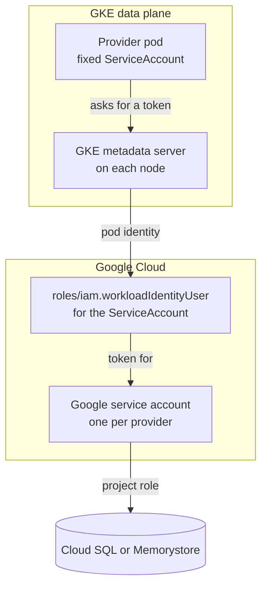

# GCP Backing

This backing builds the module's resources on Google Cloud, using the Crossplane providers from the
[GCP provider family](https://github.com/crossplane-contrib/provider-upjet-gcp). The providers
authenticate with GKE Workload Identity, so no cloud credential is stored in the cluster. Databases
and caches get private addresses in the data plane's VPC network, with no public endpoint.

For how the module fits together, see the [module README](../README.md).

| Resource | Built as | Provider | Composition |
| :------- | :------- | :------- | :---------- |
| PostgreSQL | Cloud SQL for PostgreSQL | `provider-gcp-sql` | [`postgres-composition.yaml`](postgres-composition.yaml) |
| Redis | Memorystore for Redis | `provider-gcp-redis` | [`redis-composition.yaml`](redis-composition.yaml) |

| File | What it is |
| :--- | :--------- |
| [`provider.yaml`](provider.yaml) | The providers, each with a fixed ServiceAccount name for Workload Identity |
| [`provider-config.yaml`](provider-config.yaml) | Tells the providers which project to use and to use Workload Identity |
| [`environment-config.yaml`](environment-config.yaml) | This data plane's GCP settings, read by every Composition |
| `<resource>-composition.yaml` | One Composition per resource |
| `render/<resource>/` | Sample inputs for checking a Composition without a cluster |

## How the providers authenticate

Each provider runs as its own pod, under a ServiceAccount with a fixed name. The ServiceAccount is
annotated with a Google service account, and that Google service account allows exactly this
ServiceAccount to act as it. When the provider calls GCP, the GKE metadata server on its node
exchanges the pod's identity for a short-lived token for the Google service account, and the roles
granted to the Google service account decide what the provider can do.

Nothing is added to the provider pods: no credential, token file or environment variable.



## Prerequisites

- Steps 1 to 4 of the [module install](../README.md#install) done on this data plane
- The OpenChoreo data plane running on a VPC-native GKE cluster, with Workload Identity on the
  cluster (`--workload-pool=<project>.svc.id.goog`) and its node pool (`GKE_METADATA` mode). GKE's
  documentation says turning it on for an existing node pool can disrupt running workloads
- The cluster, the databases and the caches in the same project
- Permission to enable services, create service accounts, grant project roles, reserve a global
  address and connect Private Service Access. The project's Owner role is enough
- The gcloud CLI

## Install

Run these from the module's root directory, against the cluster running the OpenChoreo data plane.

```bash
PROJECT=<project ID>
REGION=<region of the cluster>
NETWORK=<VPC network of the cluster>
```

### 1. Create a Google service account for each provider

Create one Google service account per provider, grant it the role for its service, and allow the
provider's ServiceAccount to act as it, as described in
[How the providers authenticate](#how-the-providers-authenticate):

```bash
gcloud services enable iamcredentials.googleapis.com sqladmin.googleapis.com redis.googleapis.com \
  --project=$PROJECT

gcloud iam service-accounts create xp-provider-gcp-sql --project=$PROJECT \
  --display-name="Crossplane provider-gcp-sql for OpenChoreo"
gcloud projects add-iam-policy-binding $PROJECT --condition=None --format=none \
  --member="serviceAccount:xp-provider-gcp-sql@$PROJECT.iam.gserviceaccount.com" \
  --role=roles/cloudsql.admin
gcloud iam service-accounts add-iam-policy-binding \
  xp-provider-gcp-sql@$PROJECT.iam.gserviceaccount.com --project=$PROJECT --format=none \
  --role=roles/iam.workloadIdentityUser \
  --member="serviceAccount:$PROJECT.svc.id.goog[crossplane-system/provider-gcp-sql]"

gcloud iam service-accounts create xp-provider-gcp-redis --project=$PROJECT \
  --display-name="Crossplane provider-gcp-redis for OpenChoreo"
gcloud projects add-iam-policy-binding $PROJECT --condition=None --format=none \
  --member="serviceAccount:xp-provider-gcp-redis@$PROJECT.iam.gserviceaccount.com" \
  --role=roles/redis.admin
gcloud iam service-accounts add-iam-policy-binding \
  xp-provider-gcp-redis@$PROJECT.iam.gserviceaccount.com --project=$PROJECT --format=none \
  --role=roles/iam.workloadIdentityUser \
  --member="serviceAccount:$PROJECT.svc.id.goog[crossplane-system/provider-gcp-redis]"
```

Leave out the providers for resources this data plane does not offer.

`roles/cloudsql.admin` and `roles/redis.admin` cover every Cloud SQL instance and every Memorystore
for Redis instance in the project, and grant more than the providers use. Use a project that holds
only resources this backing creates, or grant narrower custom roles.

The `workloadIdentityUser` binding names a ServiceAccount that Crossplane creates in the next step.
It matches by namespace and name, so it does not need to exist yet.

### 2. Install the providers

[`provider.yaml`](provider.yaml) names each provider's Google service account by project. Fill in
the project as you apply it:

```bash
sed "s/<project>/$PROJECT/g" gcp/provider.yaml | kubectl apply -f -
kubectl wait providers.pkg.crossplane.io --all --for=condition=Healthy --timeout=10m
```

Installing a provider from the family also installs `provider-family-gcp`, which owns the
ProviderConfig types and needs no GCP access. Each provider's ServiceAccount name is fixed in its
`DeploymentRuntimeConfig`, so the binding from step 1 keeps matching across provider upgrades.

Check that each provider's ServiceAccount names its Google service account:

```bash
kubectl get serviceaccounts -n crossplane-system provider-gcp-sql provider-gcp-redis \
  -o custom-columns='NAME:.metadata.name,GOOGLE SERVICE ACCOUNT:.metadata.annotations.iam\.gke\.io/gcp-service-account'
```

### 3. Configure the provider credentials

Apply [`provider-config.yaml`](provider-config.yaml), with the project filled in:

```bash
sed "s/<project>/$PROJECT/g" gcp/provider-config.yaml | kubectl apply -f -
```

GCP resources in any namespace use the `ClusterProviderConfig` named `default` unless they say
otherwise, so this one object covers every cell namespace. It also means that anyone who can create
GCP managed resources (`*.gcp.m.upbound.io`) in any namespace on the data plane acts with the
providers' Google service accounts. Keep that permission to platform engineers.

Check that the providers' credentials work, without creating anything, by asking each provider about
an instance that does not exist. `managementPolicies: ["Observe"]` only reads:

```bash
kubectl apply -f - <<EOF
apiVersion: sql.gcp.m.upbound.io/v1beta1
kind: DatabaseInstance
metadata:
  name: credentials-check
  namespace: default
  annotations:
    crossplane.io/external-name: credentials-check
spec:
  managementPolicies: ["Observe"]
  forProvider:
    region: $REGION
---
apiVersion: redis.gcp.m.upbound.io/v1beta1
kind: Instance
metadata:
  name: credentials-check
  namespace: default
  annotations:
    crossplane.io/external-name: credentials-check
spec:
  managementPolicies: ["Observe"]
  forProvider:
    region: $REGION
EOF
kubectl wait -n default databaseinstances.sql.gcp.m.upbound.io/credentials-check \
  instances.redis.gcp.m.upbound.io/credentials-check --for=condition=Synced=False --timeout=5m
kubectl get -n default databaseinstances.sql.gcp.m.upbound.io/credentials-check \
  instances.redis.gcp.m.upbound.io/credentials-check \
  -o custom-columns='KIND:.kind,MESSAGE:.status.conditions[?(@.type=="Synced")].message'
kubectl delete -n default databaseinstances.sql.gcp.m.upbound.io/credentials-check \
  instances.redis.gcp.m.upbound.io/credentials-check
```

Both should say `observe failed: external resource does not exist`: GCP answered that no such
instance exists, so the provider reached it with valid credentials. The check waits for the
condition rather than a fixed time: in testing, providers installed a minute earlier had not acted on
the objects 60 seconds later. Any other message comes from GCP
or from the credentials, and `kubectl describe` on the object shows it in full.

### 4. Create the networking

Cloud SQL instances get their private addresses through Private Service Access, which peers the
data plane's network with a network Google manages. Set it up once per network: reserve an address
range for the instances, then connect it.

```bash
gcloud services enable servicenetworking.googleapis.com --project=$PROJECT
gcloud compute addresses create openchoreo-crossplane-psa --project=$PROJECT \
  --global --purpose=VPC_PEERING --prefix-length=20 --network=$NETWORK \
  --description="Private Service Access range for Cloud SQL created by Crossplane for OpenChoreo"
gcloud services vpc-peerings connect --project=$PROJECT \
  --service=servicenetworking.googleapis.com --ranges=openchoreo-crossplane-psa --network=$NETWORK
```

GCP picks a free `/20` for the range. Connecting takes about a minute. If the network already has
Private Service Access, skip this step. GCP's documentation says Cloud SQL uses the existing
connection; this backing was tested with a connection created here.

Memorystore needs nothing created beforehand. With its first instance in the network, it creates a
peering of its own, named `redis-peer-<number>`.

Check that the peering is active:

```bash
gcloud compute networks peerings list --network=$NETWORK --project=$PROJECT
```

Pods reach both services directly. On a VPC-native cluster, pod addresses come from a range on the
cluster's subnet, and the peering carries that range to Google's network, so no firewall rule or NAT
is needed.

### 5. Configure this data plane's settings

Edit [`environment-config.yaml`](environment-config.yaml) with the region and the network (see
[Settings](#settings)), then apply it.

```bash
kubectl apply -f gcp/environment-config.yaml
```

### 6. Install the Compositions

Apply the Composition for each resource this data plane should offer:

```bash
kubectl apply -f gcp/postgres-composition.yaml
kubectl apply -f gcp/redis-composition.yaml
```

Then return to the [module install](../README.md#6-add-the-resourcetypes) to add the ResourceTypes.

## Settings

Every GCP Composition reads the `gcp` EnvironmentConfig on its data plane. These settings are shared
by all of them. Each resource's settings are under its own key, described in that resource's section
below. The project comes from the `ClusterProviderConfig`.

| Field | Purpose |
| :---- | :------ |
| `region` | GCP region for new resources: the region of the data plane's cluster |
| `network` | The data plane's VPC network, as `projects/<project>/global/networks/<network>` |
| `namePrefix` | Prepended to the name of every GCP resource the Compositions create. Lowercase letters, digits and hyphens, starting with a letter |
| `labels` | Optional. Labels added to every GCP resource the Compositions create. Keys and values use lowercase letters, digits, hyphens and underscores; values are written as strings |

The provider adds no labels of its own to Cloud SQL instances, and only
`goog-terraform-provisioned: true` to Memorystore instances. Nothing in GCP points back to the
managed resource, so use `labels` to mark what the Compositions create.

> [!WARNING]
> The provider finds Cloud SQL and Memorystore instances by name. If a new instance's name matches
> one Crossplane did not create, it takes that instance over, and deleting the Resource deletes it.
> Keep `namePrefix` distinct from anything else in the project. Data planes that share a project
> each need their own `namePrefix`: names come from the Resource and its namespace, which can be
> the same on two data planes.
>
> The Compositions only reference the network by name. Apart from the peering Memorystore adds with
> its first cache, nothing changes it, so deleting a Resource never touches the networking.

## Checking a Composition

`crossplane composition render` runs a Composition's functions locally, in Docker, and prints what
Crossplane would create, without a cluster. Each resource has sample inputs under
`render/<resource>/`: a composite resource, and the GCP resources as they look once GCP has
finished. Run the commands in each resource's section from the module's root directory.

With Colima, point the CLI at its socket first:
`export DOCKER_HOST=unix://$HOME/.colima/default/docker.sock`.

## PostgreSQL

[`postgres-composition.yaml`](postgres-composition.yaml) builds a `PostgresInstance` as a Cloud SQL
for PostgreSQL instance.

### What it creates

For each `PostgresInstance`, in the same namespace:

| Resource | Purpose |
| :------- | :------ |
| `DatabaseInstance` | The instance: Enterprise edition, a private IP in `network` and no public IP, encrypted connections only |
| `Database` | The application database |
| `User` | The application user, with its password read from the Secret `<name>-conn` |
| Secret `<name>-conn` | The password, under `password`. The Composition generates it, because the provider cannot, and keeps it from then on. It never leaves the data plane |

The provider cannot generate a Cloud SQL password, so the Composition generates a random
32-character password the first time it runs and writes it to `<name>-conn`. From then on it copies
the password back from that Secret, so it does not change. If the Secret is deleted, the Composition
generates a new password and the provider sets it on the user, a few minutes later on its next poll
(about three and a half minutes in testing). Workloads keep the old password until they restart.

The database and the user leave `Delete` out of their management policies. Cloud SQL removes both
with the instance, so Crossplane removes their objects without asking GCP. Crossplane deletes a
composite resource's resources all at once, and Cloud SQL removes an instance within seconds, so a
database or user that asked GCP after the instance had gone would get an error and never finish
deleting.

### Outputs

| [Output](../apis/postgres/README.md#outputs) | Filled from |
| :----- | :---------- |
| `host` | The instance's private IP address |
| `port` | `5432` |
| `database` | The database it created |
| `username` | `postgres.username` |
| `password` | The Secret `<name>-conn` |

### Settings

Under `postgres` in the `gcp` EnvironmentConfig:

| Field | Purpose |
| :---- | :------ |
| `username` | User created for the application on each new instance. Cloud SQL's system users and roles, such as `cloudsqladmin` and `cloudsqlsuperuser`, cannot be used, and `postgres` is the instance's default admin user |

Instance names are unique per project: lowercase letters, digits and hyphens, starting with a
letter. Each name is `namePrefix`, the `PostgresInstance` name and a short hash of its namespace, so
Resources with the same name in different OpenChoreo namespaces or projects get different instances.
Names that would be longer than 63 characters, or that had characters to replace or hyphens to
collapse, get a hash of the full name and are cut to fit. An instance keeps its name once created.

A deleted instance's name can be used again. In testing, deleting a binding and creating it again
gave the new instance the same name.

### Sizes

| `size` | Machine type | Storage |
| :----- | :----------- | :------ |
| `small` | `db-custom-1-3840` (1 vCPU, 3.75 GB) | 32 GB SSD |
| `medium` | `db-custom-2-7680` (2 vCPUs, 7.5 GB) | 64 GB SSD |
| `large` | `db-custom-4-15360` (4 vCPUs, 15 GB) | 128 GB SSD |

Every size runs in a single zone, with automatic storage increases and automated backups off. Only
`small` has been tested against GCP; `medium` and `large` have been checked against the provider's
schema.

The Composition sets the major version only, and Cloud SQL picks the minor version (16.15 for `"16"`
at the time of testing).

Changing an existing database's size or version has not been tested.

> [!WARNING]
> Deleting the binding deletes the instance and its database. The instance has no automated backups.
> Export the data first if it matters.

### Networking

The instance has a private IP address in `network` and no public IP. Any client in the network can
reach it on port 5432; there is no equivalent of a security group in front of it. It accepts only
encrypted connections, so clients should connect with `sslmode=require`. The address is an IP
address, not a hostname.

### What to expect

- **A new database takes about six to twelve minutes to reach the Workload.** In two runs (`small`,
  us-central1), GCP had the instance running after about three and five minutes, and the
  `PostgresInstance` was Ready after five and seven and a half, once the database and user existed.
  The binding followed one and a half and three and a half minutes later, and a dependent component
  connected straight after.
- **The database and user fail until the instance is running.** Their objects report
  `Invalid request since instance is not running` for the first few minutes, then become Ready on
  their own.
- **Deletion is quick.** GCP removed the instance within a minute of the binding being deleted, and
  the database, the user and `<name>-conn` went with it.

### Checking the Composition

```bash
# First reconcile: nothing exists in GCP yet
crossplane composition render gcp/render/postgres/xr.yaml gcp/postgres-composition.yaml functions.yaml \
  --xrd apis/postgres/definition.yaml \
  --required-resources gcp/environment-config.yaml

# A later reconcile: the PostgresInstance gets its address and becomes Ready, keeping its password
crossplane composition render gcp/render/postgres/xr.yaml gcp/postgres-composition.yaml functions.yaml \
  --xrd apis/postgres/definition.yaml \
  --required-resources gcp/environment-config.yaml \
  --observed-resources gcp/render/postgres/observed.yaml
```

The first render prints a newly generated password in the Secret, a different one each time. The
second keeps the fake one from `observed.yaml`.

## Redis

[`redis-composition.yaml`](redis-composition.yaml) builds a `RedisInstance` as a Memorystore for
Redis instance.

### What it creates

For each `RedisInstance`, in the same namespace:

| Resource | Purpose |
| :------- | :------ |
| `Instance` | The cache, on a private IP reached through Memorystore's peering with `network`, with AUTH on and in-transit encryption (TLS) off |
| Secret `<name>-conn` | The AUTH string, under `password`. The provider writes it to its own connection Secret, `<name>-provider-conn`, under a different key; the Composition copies it to the name the ResourceType expects |

The Composition sets no Redis version, so Memorystore uses its default at creation (Redis 7.0 at the
time of testing).

TLS is off because Memorystore's TLS uses a certificate authority of its own for each instance,
which clients must be given, and the [`RedisInstance` outputs](../apis/redis/README.md#outputs) have
no place for it.

### Outputs

| [Output](../apis/redis/README.md#outputs) | Filled from |
| :----- | :---------- |
| `host` | The instance's private IP address |
| `port` | The instance's port, `6379` |
| `password` | The Secret `<name>-conn` |

Clients connect without TLS and authenticate with the AUTH string alone, with no username. A client
that does not authenticate is refused.

### Settings

Redis has no settings of its own in the `gcp` EnvironmentConfig.

Instance IDs are unique per project and region, 1 to 40 lowercase letters, digits and hyphens,
starting with a letter and ending with a letter or digit. Each ID is `namePrefix`, the
`RedisInstance` name and a short hash of its namespace, so Resources with the same name in different
OpenChoreo namespaces or projects get different caches. IDs that would be too long, which most are,
or that had characters to replace or hyphens to collapse, get a hash of the full name and are cut to
fit. A cache keeps its ID once created.

### Sizes

| `size` | Tier | Memory |
| :----- | :--- | :----- |
| `small` | Basic | 1 GB |
| `medium` | Standard, with a replica in another zone and automatic failover | 2 GB |
| `large` | Standard, with a replica in another zone and automatic failover | 5 GB |

Only `small` has been tested against GCP; `medium` and `large` have been checked against the
provider's schema. Changing an existing cache's size has not been tested.

### Networking

The cache has a private IP address, from a small range Memorystore picks, reached through
Memorystore's own peering with `network`. Any client in the network can reach it.

> [!WARNING]
> With TLS off, the AUTH string and the data cross the network unencrypted. Use this backing only on
> a network you trust, or add TLS to the Composition and give clients the certificate authority from
> `<name>-provider-conn`.

### What to expect

- **A new cache takes about seven minutes to reach the Workload.** In two runs (`small`,
  us-central1), GCP had the cache ready, and the `RedisInstance` Ready, after three and a half and
  five minutes. Both times the binding was Ready about six minutes after it was created, and a
  dependent component connected straight after.
- **Deletion takes a few minutes.** GCP removed the cache about three and four minutes after the
  binding was deleted, and `<name>-provider-conn` went with it.
- **Memorystore's peering stays.** Deleting the last cache leaves the `redis-peer-<number>` peering
  on the network. The [uninstall](#uninstall) removes it.

### Checking the Composition

```bash
# First reconcile: nothing exists in GCP yet
crossplane composition render gcp/render/redis/xr.yaml gcp/redis-composition.yaml functions.yaml \
  --xrd apis/redis/definition.yaml \
  --required-resources gcp/environment-config.yaml

# A later reconcile: the RedisInstance gets its address and port, and becomes Ready
crossplane composition render gcp/render/redis/xr.yaml gcp/redis-composition.yaml functions.yaml \
  --xrd apis/redis/definition.yaml \
  --required-resources gcp/environment-config.yaml \
  --required-resources gcp/render/redis/provider-conn.yaml \
  --observed-resources gcp/render/redis/observed.yaml
```

## Uninstall

Delete every binding of a Resource built by this backing first, and wait until no GCP managed
resource is left. If a provider is removed while its resources still exist, they keep running in GCP
with nothing left to delete them.

```bash
# 1. Confirm no managed resources are left
kubectl get managed -A

# 2. Remove the Compositions, the settings, the credentials and the providers
kubectl delete --ignore-not-found -f gcp/postgres-composition.yaml -f gcp/redis-composition.yaml
kubectl delete -f gcp/environment-config.yaml
kubectl delete clusterproviderconfigs.gcp.m.upbound.io default
sed "s/<project>/$PROJECT/g" gcp/provider.yaml | kubectl delete -f -
kubectl delete providers.pkg.crossplane.io crossplane-contrib-provider-family-gcp

# 3. In GCP: Memorystore's peering, once no Memorystore for Redis instance is left in the region
if [ -z "$(gcloud redis instances list --region=$REGION --project=$PROJECT --format='value(name)')" ]; then
  for PEERING in $(gcloud compute networks peerings list --network=$NETWORK --project=$PROJECT \
      --flatten=peerings --filter='peerings.name ~ ^redis-peer-' --format='value(peerings.name)'); do
    gcloud compute networks peerings delete "$PEERING" --network=$NETWORK --project=$PROJECT --quiet
  done
fi

# 4. In GCP: Private Service Access, then its range
gcloud services vpc-peerings delete --service=servicenetworking.googleapis.com \
  --network=$NETWORK --project=$PROJECT --quiet &&
  gcloud compute addresses delete openchoreo-crossplane-psa --global --project=$PROJECT --quiet

# 5. In GCP: the Google service accounts and their project roles
gcloud projects remove-iam-policy-binding $PROJECT --condition=None --format=none \
  --member="serviceAccount:xp-provider-gcp-sql@$PROJECT.iam.gserviceaccount.com" \
  --role=roles/cloudsql.admin
gcloud projects remove-iam-policy-binding $PROJECT --condition=None --format=none \
  --member="serviceAccount:xp-provider-gcp-redis@$PROJECT.iam.gserviceaccount.com" \
  --role=roles/redis.admin
gcloud iam service-accounts delete xp-provider-gcp-sql@$PROJECT.iam.gserviceaccount.com \
  --project=$PROJECT --quiet
gcloud iam service-accounts delete xp-provider-gcp-redis@$PROJECT.iam.gserviceaccount.com \
  --project=$PROJECT --quiet
```

Memorystore's peering serves every Memorystore for Redis instance in the network. The check covers
`$REGION` only, so leave the peering if the network has caches in other regions.

Skip step 4 if the network had Private Service Access before this backing, or if anything else in it
still uses it. GCP's documentation says it refuses to delete the connection until four days after
the last Cloud SQL instance in the network was deleted, so run step 4 again after that if it fails.
The range is deleted only once the connection is gone.

Then continue with the [module uninstall](../README.md#uninstall).

## Compatibility

| Component | Compatible version | Notes |
| :-------- | :----------------- | :---- |
| **provider-gcp-sql** | `v3.1.x` | Verified against v3.1.0, from `xpkg.crossplane.io/crossplane-contrib`. Uses the namespaced `*.gcp.m.upbound.io` API groups. |
| **provider-gcp-redis** | `v3.1.x` | Verified against v3.1.0, from `xpkg.crossplane.io/crossplane-contrib`. |
| **GKE** | `1.36` | Verified on GKE 1.36.4 (Standard, zonal, VPC-native, kube-proxy networking) with Workload Identity. |
